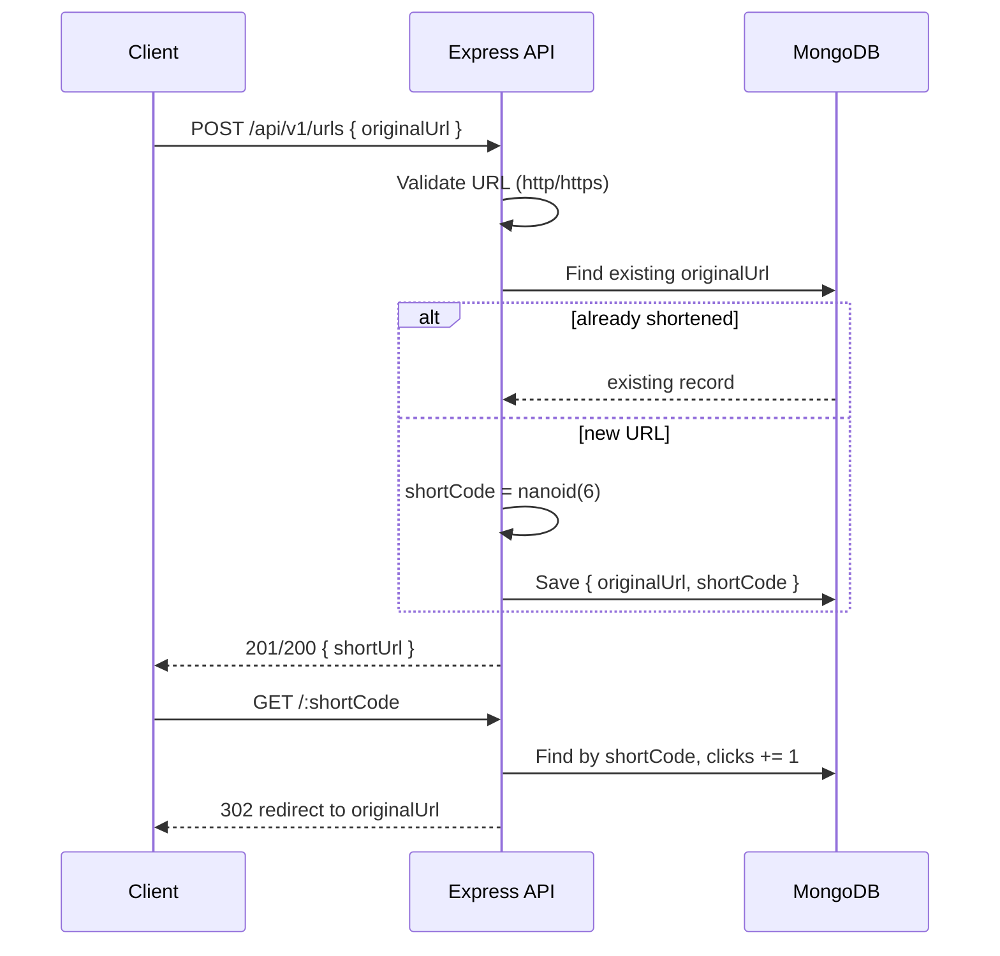

# URL Shortener API

A REST API that turns long URLs into short 6-character links, redirects visitors to the original address, and counts every click.

Built with **Node.js, Express 5 and MongoDB** using a layered structure (routes → controllers → models).


---

## Features

- **Shorten any URL** into a collision-resistant 6-character code generated with [nanoid](https://github.com/ai/nanoid)
- **Input validation**: only well-formed `http://` / `https://` URLs are accepted
- **No duplicates**: shortening the same URL twice returns the existing short link
- **Fast redirects** via an indexed, unique `shortCode` lookup
- **Click tracking**: every redirect increments a `clicks` counter
- **Timestamps** (`createdAt`, `updatedAt`) on every link
- Consistent JSON response shape: `{ success, message, data }`

## How it works



## API reference

Base URL (local): `http://localhost:5000`

| Method | Endpoint | Description |
|---|---|---|
| `GET` | `/` | Health check |
| `POST` | `/api/v1/urls` | Create a short URL |
| `GET` | `/:shortCode` | Redirect to the original URL and count the click |

### Create a short URL

```bash
curl -X POST http://localhost:5000/api/v1/urls \
  -H "Content-Type: application/json" \
  -d '{"originalUrl": "https://github.com/JayantBansal900"}'
```

**201 Created**

```json
{
  "success": true,
  "message": "Short URL created successfully",
  "data": {
    "originalUrl": "https://github.com/JayantBansal900",
    "shortCode": "aB3xY9",
    "clicks": 0,
    "createdAt": "2026-01-01T10:00:00.000Z",
    "updatedAt": "2026-01-01T10:00:00.000Z",
    "shortUrl": "http://localhost:5000/aB3xY9"
  }
}
```

Shortening a URL that already exists returns **200 OK** with `"message": "Short URL already exists"` and the same link.

**400 Bad Request**: missing or invalid URL

```json
{ "success": false, "message": "Please provide a valid URL." }
```

### Use a short URL

```bash
curl -i http://localhost:5000/aB3xY9
# HTTP/1.1 302 Found
# Location: https://github.com/JayantBansal900
```

Unknown codes return **404** `{ "success": false, "message": "Short URL not found" }`.

## Data model

| Field | Type | Notes |
|---|---|---|
| `originalUrl` | String | Required, trimmed |
| `shortCode` | String | Required, unique, indexed |
| `clicks` | Number | Defaults to `0` |
| `createdAt` / `updatedAt` | Date | Added automatically |

## Project structure

```
src/
├── server.js                 # Loads env, connects to MongoDB, starts the server
├── app.js                    # Express app and route wiring
├── config/db.js              # MongoDB connection
├── routes/url.routes.js      # /api/v1/urls routes
├── controllers/url.controller.js  # Create + redirect logic
└── models/url.model.js       # Mongoose schema
```

## Run it locally

**Prerequisites:** Node.js 20+ and a MongoDB database (local or a free [MongoDB Atlas](https://www.mongodb.com/atlas) cluster).

```bash
git clone https://github.com/JayantBansal900/url-shortener-api.git
cd url-shortener-api
npm install
```

Create a `.env` file in the project root:

```env
MONGODB_URI=mongodb+srv://<user>:<password>@<cluster>/url-shortener
PORT=5000
```

Start the server:

```bash
npm run dev    # with auto-reload (nodemon)
npm start      # plain node
```

## Roadmap

- [ ] Custom aliases (`/my-link`)
- [ ] Link expiry dates
- [ ] Rate limiting on link creation
- [ ] Centralised error-handling middleware
- [ ] Stats endpoint (`GET /api/v1/urls/:shortCode/stats`)
- [ ] Automated tests and CI

## Author

**Jayant Bansal** · [GitHub](https://github.com/JayantBansal900)
